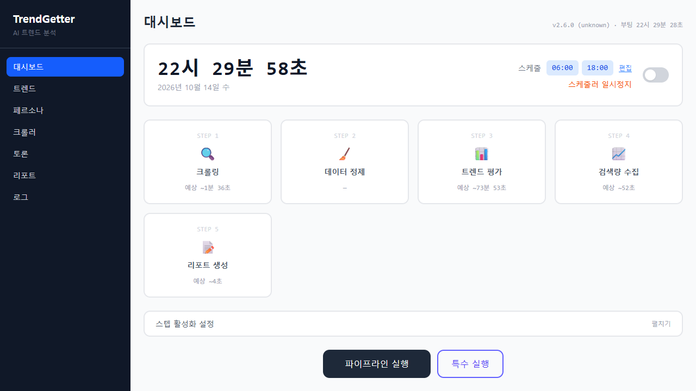
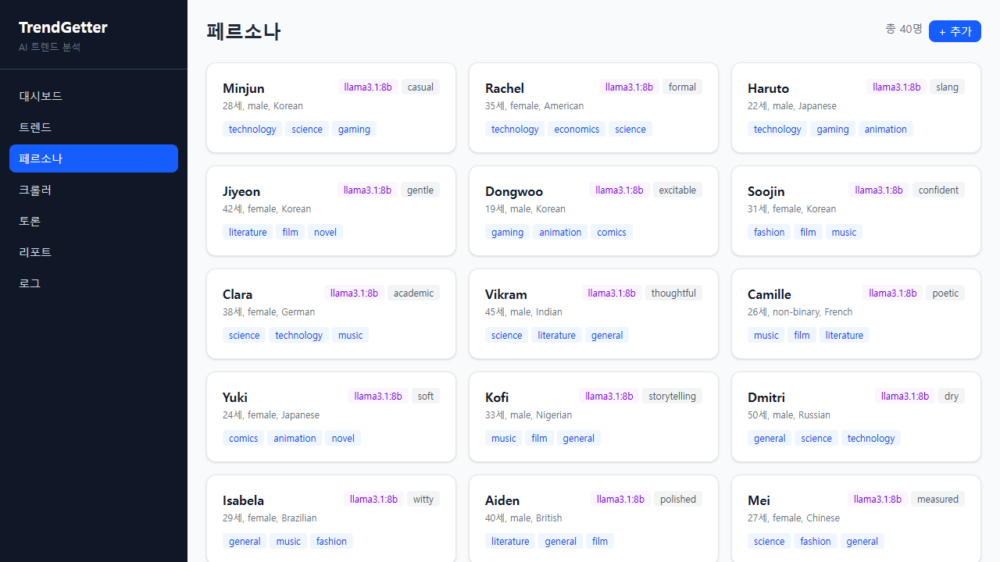

# TrendGetter

AI 페르소나가 웹에서 모은 콘텐츠를 읽고 토론하며 트렌드를 분석하는 시스템. 성격 · 관심사 · 국적이 다른 페르소나들이 160여 개 RSS · HTML 소스의 글을 읽고 **로컬 LLM(Ollama)**으로 토론해 키워드의 흐름을 추적한다.

## 설치 · 실행 (Windows)

1. [Ollama](https://ollama.com/download/windows) 설치 (로컬 LLM 실행기)
2. [Releases](../../releases)에서 `TrendGetter-<버전>-windows.zip`을 받아 압축 해제
3. `play.bat` 실행 — 처음에는 LLM 모델 `llama3.1:8b`(약 4.9GB)를 받고 데이터베이스를 만든다. 브라우저가 열리고, 검은 창을 닫으면 종료

Python · PostgreSQL 포함, 따로 설치할 것은 Ollama뿐. 데이터베이스는 압축을 푼 폴더의 `db`에 저장된다 (폴더 경로에 한글 등 영문이 아닌 글자가 있으면 `C:\ProgramData\parkrye\TrendGetter`). 창을 X로 닫으면 데이터베이스가 백그라운드에 남을 수 있는데, 다음 실행 때 그대로 이어 쓰고 완전히 끄려면 `stop.bat`.

RAM 16GB 이상 권장. GPU(VRAM 6GB 이상)가 있으면 Ollama가 자동으로 써서 훨씬 빠르다.

## 기능

- **자동 크롤링**: 뉴스 · 기술 · 과학 · 커뮤니티 등 카테고리별 RSS · HTML 소스. 소스 추가 · 삭제 가능
- **AI 토론**: 페르소나들이 LLM으로 트렌드에 대해 다자간 토론
- **트렌드 분석**: 키워드 생명주기 추적 (Emerging → Growing → Saturated → Declining → Dead)
- **리포트**: 주기별 트렌드 변화, 합의 · 충돌 분석, 키워드 네트워크 시각화
- **파이프라인 제어**: 크롤링 → 정제 → 트렌드 평가 → 검색량 수집 → 리포트를 웹에서 실행 · 중단, 스케줄(기본 06:00 · 18:00) 토글
- **로그 뷰어**: 웹에서 실시간 로그 확인 · 다운로드

크롤링은 인터넷에 공개된 소스를 읽는다. 분석 · 토론은 모두 내 PC의 LLM에서 이루어진다.

## 문의

버그 · 제안은 [Issues](../../issues)에.
